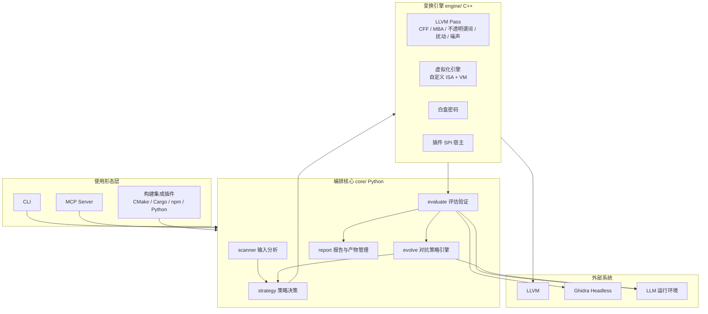

# Anti-REA Skill 概要设计说明书（HLD）

## 文档信息

- **文档版本**：v1.1（2026-10-15 经 M1 架构门禁基线化）
- **创建日期**：2026-10-15
- **阶段**：S1 概要设计（任务 HD-01…HD-10）
- **上游依据**：`docs/requirements/SRS.md` v1.2（M0 基线）、`plan/anti-rea-project-plan.md` v1.1
- **状态**：**已基线**（M1 架构门禁通过，4 项 PoC 全部通过，见 `poc-plan.md §6`）
- **配套交付物**：`interfaces.md`（接口契约）、`ADR.md`（架构决策记录）、`poc-plan.md`（PoC 方案）、`../schemas/*.json`（数据契约）

---

## 1. 引言

### 1.1 目的

本 HLD 把 SRS 的需求基线转化为稳定的系统架构与组件划分，冻结跨模块接口（见 `interfaces.md`）与数据契约（见 `schemas/`），并对高风险技术给出 PoC 去风险方案（见 `poc-plan.md`），作为详细设计（S2）的输入。

### 1.2 范围

覆盖 6 大功能层（输入分析 / 策略决策 / 变换执行 / 构建集成 / 评估验证 / 对抗策略引擎）的组件划分、依赖方向、运行时数据流、部署形态、插件机制与仓库骨架。不覆盖算法级细节（属 S2 详细设计）。

### 1.3 设计原则

| 原则 | 说明 |
| :--- | :--- |
| **单向依赖** | 使用形态 → 编排核心 → 变换引擎 → 外部系统，禁止反向依赖 |
| **契约先行** | 跨模块只经 `interfaces.md` 定义的契约交互，数据经 Schema 校验 |
| **选择性变换** | 引擎只处理策略白名单，非白名单代码零改动（FR-C6 / CQ-01） |
| **可复现** | 随机性由 `seed` 统一注入；产物带可复现元数据（NFR-04 / NFR-08） |
| **可插拔** | 新变换经插件 SPI 注册，不改核心引擎（FR-C11） |
| **离线优先** | 除攻击模拟与策略进化外全流程离线（NFR-06）；LLM 出站受 CQ-05 约束 |

---

## 2. 架构总览（HD-01）

### 2.1 分层组件图



### 2.2 依赖方向

- **使用形态层**依赖**编排核心**（单向）；
- **编排核心**通过 `protect` 调用**变换引擎**；引擎不反向调用核心；
- **变换引擎**依赖 **LLVM**；**评估层**依赖 **Ghidra / LLM**；
- 评估结果经 `evolve` 回流**策略决策层**，构成自适应闭环（不构成编译期循环依赖）。

### 2.3 运行时数据流（端到端）

```text
源码/二进制
   │ (1) scan
   ▼
asset_manifest.json ───► (2) plan ───► protection_policy.yaml
                                              │ (3) protect
                                              ▼
                                     保护产物 + 变换日志
                                              │ (4) verify
                                              ▼
                                     verification_report.json
                                              │ (5) attack_sim
                                              ▼
                                        eval_report.json
                                              │ (6) report
                                              ▼
                                    protection_report.{json,md,html}
                                              │ (7) evolve（可选、异步）
                                              └──► 更新策略库 / 回注 strategy
```

每一步产物均通过对应 Schema 校验；`run_id` 贯穿全流程，用于关联产物与可复现元数据。

### 2.4 部署形态（HD-09）

| 形态 | 说明 | 适用 |
| :--- | :--- | :--- |
| **A. 本机 CLI** | `core`(Python) + `engine`(.so/.dll) + 本地 LLVM/Ghidra；离线可用 | 开发者、单机保护 |
| **B. 容器** | 将 LLVM / Ghidra / engine 打包进镜像，环境可复现 | CI、团队一致环境 |
| **C. MCP Server** | stdio JSON-RPC，被 AI Agent 调用；内部复用 `core` | Agent 集成（主使用形态） |

三种形态共享同一 `core`，差异仅在启动与调用方式。

---

## 3. 组件与模块职责（HD-03 输入）

| 组件 | 语言 | 职责 | 输入 | 输出 | 依赖 |
| :--- | :--- | :--- | :--- | :--- | :--- |
| `scanner` | Python | 工程类型识别、敏感资产识别、分级、SBOM、拒绝判定 | 工程路径 | `asset_manifest` | - |
| `strategy` | Python | 策略模板匹配、预算优化、MTD 配置、冲突检测 | `asset_manifest` + 预算 | `protection_policy` | `policies/` 模板库 |
| `engine.passes` | C++ / LLVM | IR 级变换：CFF / MBA / 不透明谓词 / 边界扰动 / 噪声 | IR + policy | 变换后 IR | LLVM |
| `engine.vm` | C++ | 虚拟化：自定义 ISA、字节码编译、解释器嵌入 | IR + 覆盖率参数 | 含 VM 的产物 | LLVM |
| `engine.wbc` | C++ | 白盒密码：查找表编码、运行时密钥重构与销毁 | 目标函数 + 密钥 | 变换后代码 | - |
| `engine.spi` | C++ | 变换插件宿主：注册、能力声明、生命周期钩子 | 插件 | - | - |
| `evaluate` | Python | 功能保持、性能基准、静态/动态/跨版本攻击模拟、指标计算 | 产物 | `verification_report` / `eval_report` | Ghidra、LLM |
| `evolve` | Python / DEAP | 多模型探测、策略基因进化、策略沉淀与迁移 | `eval_report` | 更新策略 / 知识库 | LLM |
| `report` | Python | 报告生成（json/md/html）、产物目录、可复现元数据 | run 数据 | 报告 + 元数据 | - |
| `integrations` | 多语言 | CLI、CMake/Cargo/npm/Python 插件、MCP Server | - | - | `core` |

---

## 4. 关键技术决策（摘要，详见 `ADR.md`）

| 决策 | 结论 | ADR |
| :--- | :--- | :--- |
| IR 变换实现方式 | LLVM 18+ Pass 插件，版本锁定，升级走适配分支 | ADR-001 |
| 虚拟化引擎 | 自研（自定义 ISA + VM），参考 ASGARD-5877，不做 Tigress 封装 | ADR-002 |
| 白盒密码路线 | v1.0 自研查找表编码（轻量），Chow 留作增强，S1 PoC-4 复核 | ADR-003 |
| 评估 LLM | 不绑定供应商，使用运行环境 LLM；独立会话 + 上下文消耗 90% 判定 | ADR-004 |
| 插件模型 | 进程内插件 SPI + 能力声明 + 版本校验 | ADR-005 |
| 外部工具隔离 | Ghidra / LLVM 经适配层封装，锁定版本 | ADR-006 |

---

## 5. 仓库结构与骨架规范（HD-07）

```text
anti-rea-skill/
├── engine/                 # C++：变换引擎
│   ├── passes/             #   LLVM Pass：CFF / MBA / 不透明谓词 / 扰动 / 噪声
│   ├── vm/                 #   自定义 ISA 规范 + 字节码编译器 + VM 解释器
│   ├── wbc/                #   白盒密码
│   ├── spi/                #   插件宿主与接口头文件
│   └── CMakeLists.txt
├── core/                   # Python：编排与主逻辑
│   ├── scanner/            #   输入分析层
│   ├── strategy/           #   策略决策层
│   ├── evaluate/           #   评估验证层
│   ├── evolve/             #   对抗策略引擎（DEAP）
│   ├── report/             #   报告与产物管理
│   ├── contracts.py        #   数据契约加载与 Schema 校验
│   └── cli.py              #   CLI 入口
├── integrations/           # 集成层
│   ├── mcp_server/         #   MCP Server
│   ├── cmake/              #   CMake 插件
│   ├── cargo/              #   Cargo 插件
│   ├── npm/                #   npm postbuild 钩子
│   └── python/             #   Python build_ext 集成
├── schemas/                # JSON Schema（本目录已交付）
├── policies/               # 策略模板库 + strategy_kb
├── benchmarks/             # 攻击模拟基准题库（ground truth）
├── plugins/                # 第三方 / 示例变换插件
├── tests/                  # 单元 / 集成 / 差分 fuzz
├── docs/                   # 需求与设计文档
└── ci/                     # CI 门禁配置
```

**骨架规范**：模块内聚；跨模块只经 `core/contracts.py` 与 `interfaces.md` 定义的契约；C++ 侧只暴露稳定 ABI（必要时 C 封装），避免 Python 直接依赖 LLVM 内部符号。

---

## 6. 数据契约（HD-05）

| 对象 | Schema 文件 | 产出方 | 消费方 |
| :--- | :--- | :--- | :--- |
| 资产清单 | `schemas/asset_manifest.schema.json` | scanner | strategy |
| 防护策略 | `schemas/protection_policy.schema.json` | strategy | engine、integrations |
| 验证报告 | `schemas/verification_report.schema.json` | evaluate | report、evolve |
| 评估报告 | `schemas/eval_report.schema.json` | evaluate | report、evolve |

所有跨模块数据在边界处经 Schema 校验（`contracts.py`），校验失败即中止并报错（fail-fast）。

---

## 7. 变换插件 SPI（HD-06）

| 项 | 设计 |
| :--- | :--- |
| 注册 | 插件导出 `register(host)`；宿主在启动时加载 `plugins/` 与策略引用 |
| 能力声明 | `name()`、`capabilities()`（适用 IR / 二进制、参数 Schema、是否支持覆盖率） |
| 生命周期钩子 | `load` → `validate(cfg)` → `apply(module, cfg, seed)` → `verify(module)` |
| 版本校验 | `SPI_VERSION` 常量；宿主拒绝不兼容插件 |
| 参数 | 参数经 `params` 传入并由插件自带 Schema 校验（对应 `protection_policy.params`） |
| 隔离 | v1.0 进程内加载（可信插件）；不可信插件沙箱列为后续增强 |
| 与策略的衔接 | 策略中的 `strategies[]` 名称即插件 `name()`；未知插件名 → 策略校验失败 |

---

## 8. 构建集成设计（HD-03/HD-07）

| 集成 | 挂载点 | 说明 |
| :--- | :--- | :--- |
| CLI | `core/cli.py` | `scan/plan/protect/verify/report` 子命令（FR-D1） |
| CMake | `add_custom_command(POST_BUILD)` | 编译后对目标产物施加保护（FR-D2） |
| Cargo | `build.rs` / cargo 子命令 | Rust 构建后处理（FR-D3） |
| npm | `scripts.postbuild` | 前端 / Node 产物保护（FR-D4） |
| Python | `build_ext` 子命令 | C 扩展保护（FR-D5） |
| MCP Server | stdio JSON-RPC | 7 个工具（见 `interfaces.md`）（FR-D6） |

集成步骤统一遵循：编译 → 施加保护 → 验证 → 按 `abort_on_failure` 决定是否中止（FR-D7）。

---

## 9. 非功能设计要点

| 属性 | 设计要点 | 需求 |
| :--- | :--- | :--- |
| 性能 | 扫描 / 变换并行；按内容哈希缓存；增量处理；覆盖率与阶数受预算约束；预算预测器提前评估 | NFR-01、FR-B3 |
| 可复现 | `seed` 统一注入；记录输入指纹（哈希）、策略、引擎版本；变换确定性 | NFR-04、NFR-08 |
| 可观测 | 结构化 JSON 日志；阶段进度；错误可定位到具体资产 / 变换 | NFR-11 |
| 安全 | 依赖锁定 + SBOM；密钥 / Token 不入库；LLM 出站脱敏 + 审计 | NFR-09、CQ-05 |
| 合规 | 开源资产 `skip_transform`；加密强度分级；拒绝执行留痕 | CQ-01…03 |
| 规模 | 千文件级工程线性扫描；大产物分块处理，避免 OOM | NFR-07 |

---

## 10. 风险与去风险（详见 `poc-plan.md`）

| 风险 | 去风险 PoC |
| :--- | :--- |
| LLVM 版本 / Pass 可行性 | PoC-1 |
| Ghidra Headless 自动化稳定性 | PoC-2 |
| DEAP 策略进化可行性 | PoC-3 |
| 白盒密码方案可行性与性能 | PoC-4 |

PoC 结论写回 `ADR.md`；任一 PoC 不通过则调整方案后再进入 S2。

---

## 11. 出口准则与评审（M1，HD-10）

**出口准则（M1）**
- 所有跨模块接口在 `interfaces.md` 中有明确契约，数据契约在 `schemas/` 中可校验；
- 4 项高风险 PoC 均有明确「通过 / 调整」结论（`poc-plan.md` + `ADR.md`）；
- ADR 覆盖全部关键取舍（§4）；
- RTM「设计归属」列可映射到本 HLD 的组件表。

**M1 达成情况（2026-10-15）**：上述准则均已满足——接口契约与数据契约齐备；4 项 PoC 全部通过（`poc-plan.md §6`）；ADR-001…007 覆盖关键取舍；本文档状态已改为「已基线」。**M1 架构门禁通过**，可进入 S2 详细设计。

**架构评审 checklist**

| 检查项 | 通过标准 |
| :--- | :--- |
| 依赖方向 | 无反向依赖、无编译期循环 |
| 契约完整 | 每个跨模块调用都有输入 / 输出 / 错误码定义 |
| 可复现 | 端到端存在唯一 `seed` 与元数据路径 |
| 合规内建 | 开源跳过、拒绝执行、LLM 出站控制均有设计落点 |
| 可扩展 | 新变换、新集成不改核心 |
| 可测性 | 每个组件可独立测试（无隐藏全局状态） |