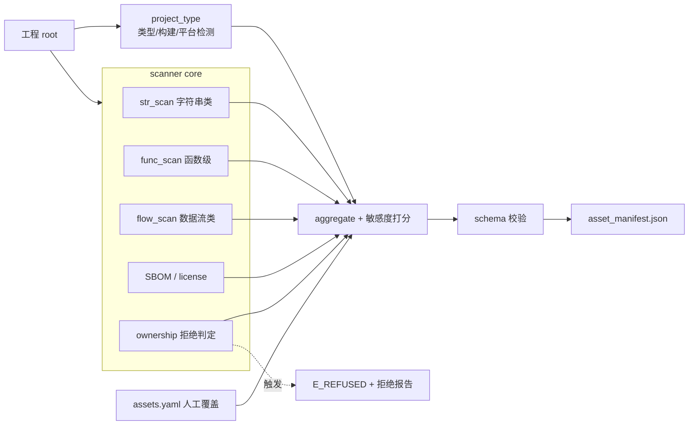

# DD-01 资产扫描详细设计（Asset Scanner）

## 文档信息

- **版本**：v1.0
- **日期**：2026-10-15
- **阶段**：S2 详细设计
- **上游**：`SRS.md` v1.2 §3.1（FR-A1…A7）、§2.5（设计约束）、`HLD.md` v1.1 §2.1/§2.2、`interfaces.md` v1.1 §2.1、`schemas/asset_manifest.schema.json`
- **关联 FR**：FR-A1…A7；跨界：FR-A4↔CQ-01、FR-A6↔CQ-03
- **状态**：初稿

---

## 1. 目标与范围

把「工程 → `asset_manifest.json`」的全过程设计到可编码级：工程类型识别、三类敏感资产扫描、敏感度分级、SBOM 与开源标记、拒绝判定、人工覆盖、Schema 校验。**不含**策略决策（DD-02）与变换（DD-03…）。

## 2. 组件与数据流



**数据流**：`scan(root, options) → project_type → 三路扫描 + SBOM → 打分合并 → 人工覆盖 → Schema 校验 → AssetManifest`。

## 3. 接口落点

| 项 | 内容 |
| :--- | :--- |
| 方法 | `scanner.scan(root: str, options: ScanOptions) -> AssetManifest \| Error` |
| `ScanOptions` | `{ include?: [glob], exclude?: [glob], assets_override?: path, allow_unknown_owner?: bool }` |
| 输出 | `asset_manifest.json`（`schemas/asset_manifest.schema.json`，Draft 2020-12） |
| 错误 | `E_INVALID_INPUT`、`E_REFUSED`、`E_UNSUPPORTED_PLATFORM` |

## 4. 工程类型检测（FR-A1）

采用**多信号加权投票**，四类信号：

| 信号 | 来源 | 权重 |
| :--- | :--- | :--- |
| 扩展名分布 | 文件后缀计数（`.c/.h/.cpp/.rs/.py/.js/.ts/.java/.cs`） | 0.30 |
| 标志文件 | `CMakeLists.txt`/`Cargo.toml`/`package.json`/`pyproject.toml`/`build.gradle`/`pom.xml`/`*.sln`/`Makefile` | 0.40 |
| 内容特征 | `#include`/`fn main`/`def `/`import `/`package `/`using System` | 0.20 |
| shebang | 首行 `#!` | 0.10 |

**语言判定**：`argmax` 归一化得分；若前两名差值 `< 0.15` → `mixed`；无信号 → `unknown`。
**构建系统**：按特异性优先命中（`cmake > cargo > gradle > maven > msbuild > pip > npm > make > unknown`）。
**目标平台**：优先级 = `options`(显式) > 构建配置（如 CMake toolchain / Cargo target / `--target`） > 架构宏（`__x86_64__`/`__aarch64__`/`_WIN32`） > 缺省 `linux-x86_64`。

```text
function detectProjectType(root):
    files = walk(root)                        # 忽略 exclude 与二进制
    lang_votes = {}, build_hit = first_marker_priority(files)
    for f in files:
        lang_votes[ext→lang(f)] += 1 * 0.30/sum_ext
        lang_votes[content_hint(f)] += 0.20
        lang_votes[shebang(f)] += 0.10
    language = argmax(lang_votes) or mixed/unknown   # 见上判定规则
    platform = pick(options, build_cfg, arch_macro, default)
    return {language, build_system, target_platform}
```

**复杂度**：单遍遍历 `O(F + L)`（F 文件数、L 总行数），满足 NFR-07 千文件级线性扫描。
**正确性思路**：标志文件是强约束（构建系统与语言高度相关），故权重最高；多信号投票对单一误信号鲁棒，保证 FR-A1 的 ≥95% 基准准确率。

## 5. 三类敏感资产扫描（FR-A2）

每类扫描对命中产出**信号集合 `signals[]`**，每条含 `{rule_id, weight, confidence, evidence}`。

### 5.1 字符串类（`type=secret`）

| 规则 | 说明 | 权重 |
| :--- | :--- | :--- |
| `str.pattern.*` | 已知密钥模式：`AKIA[0-9A-Z]{16}`、`ghp_…`、`sk-…`、`-----BEGIN … KEY-----`、`xox[baprs]-…` | 0.5 |
| `str.entropy` | 候选 token 的 Shannon 熵 `H ≥ 4.0` 且长度 `≥ 16` | 0.3 |
| `str.keyword` | 标识符/邻近含 `password|secret|token|api_key|conn|jdbc:` | 0.2 |
| `str.method` | 出现在对类字段/环境变量取值并**硬编码**赋值的语句 | 0.3 |

**确认条件**：`pattern` 命中，或（`entropy` ∧ `keyword`）；单信号不单独成案（抑误报）。

### 5.2 函数级（`type∈{crypto, license_check, algorithm, business_logic}`）

| 规则 | 说明 | 权重 |
| :--- | :--- | :--- |
| `fn.name` | 符号名语义：`encrypt/decrypt/aes/rsa/sha/hmac/license/activate/verify_signature/check_license` | 0.35 |
| `fn.api` | 调用图命中密码/授权库 API（`EVP_*`、`AES_*`、`SHA256_*`、`BCrypt*`、`CryptoJS.*`） | 0.35 |
| `fn.const` | 常量表特征（S-box、RSA 常量、magic 表） | 0.15 |
| `fn.struct` | CFG/AST 结构（密集位运算 `xor/rol/ror`、密钥调度循环） | 0.15 |

**类型归属**：取信号权重和最高者；`crypto` 优先于 `algorithm`；含 `license/activate` 语义者判 `license_check`。

### 5.3 数据流类（密钥/敏感值路径）

- 在**定义-使用图（def-use）**上做**有界污点传播**：源 `source ∈ {env, config, argv, network, file}` → 汇 `sink ∈ {crypto API, 授权比较, 内存写出, 日志}`。
- 产出 `evidence = ["source(a)→…→sink(b)"]`，并作为 `secret`/`crypto` 资产的**数据流证据**（提升敏感度，见 §6）。
- 过程内全做；过程间限制调用深度 `k ≤ 3` 以控规模。

```text
function flowScan(files):
    G = buildDefUse(files)                       # 过程内
    taints = sources(G)
    worklist = taints; paths = []
    while worklist and depth<=3:
        (v,d) = pop()
        for u in uses(G,v):                      # 传播规则：赋值/参数/返回
            if u is sink: paths += pathOf(t)
            elif d<3: push((u, d+1))
    return paths
```

**复杂度**：过程内 `O(N + E)`；跨过程受 `k` 限制，最坏 `O(k·(N+E))`。

### 5.4 规则与权重合并

`type_score(type) = min(1.0, Σ signals.weight)`（按类型分组后封顶 1.0）。
分类判定：取 `type_score` 最高且 `≥ 0.35`（阈值 τ_type）者；否则 `unknown`。

## 6. 敏感度打分公式（FR-A3）

对每个资产计算 `score ∈ [0,100]`：

```text
score = 100 * ( 0.35*T + 0.25*C + 0.20*E + 0.20*D )
  T = type_weight(type)        # 见下表
  C = max_confidence(signals)  # 信号置信度上界
  E = exposure                 # 硬编码常量 1.0 / 配置 0.6 / 环境派生 0.4 / 外部 0.2
  D = dataflow                 # 在 source→sink 路径 1.0 / 部分 0.5 / 无 0
```

| type | T | | type | T |
| :--- | :--- | :--- | :--- | :--- |
| secret | 1.00 | | business_logic | 0.50 |
| crypto | 0.95 | | ui | 0.20 |
| license_check | 0.90 | | util | 0.15 |
| algorithm | 0.80 | | open_source | 0.00 |
| protocol | 0.60 | | unknown | 0.10 |

**分级阈值**：`P0: score ≥ 80`；`P1: 60–79`；`P2: 40–59`；`P3: < 40`。
**强制规则**：`type=open_source` ⇒ `P3` 且 `skip_transform=true`（FR-A4）；`evidence` 至少含一条支撑规则（可解释，FR-A3）。

## 7. 开源组件识别与 SBOM（FR-A4）

- **识别信号**：`LICENSE*/COPYING`、SPDX 头（`SPDX-License-Identifier:`）、依赖清单（`Cargo.lock`/`package-lock.json`/`go.mod`/`requirements.txt`）、`vendor/`/`third_party/`/`node_modules/` 目录、已知 OSS 指纹。
- **产出**：SBOM（**CycloneDX JSON**，缺省；可选 SPDX）；开源资产 `type=open_source`、`license` 字段填 SPDX ID、`skip_transform=true`、`sensitivity=P3`。
- **约束**：开源文件在变换阶段**字节级零改动**（FR-A4 ↔ CQ-01），由 DD-03 的 `protect` 复核。

## 8. 拒绝执行判定（FR-A6 / CQ-03）

```text
function ownershipCheck(root, options):
    if options.allow_unknown_owner: return OK          # 显式声明归属
    signals = [has_LICENSE(root), has_copyright_header(root), has_git_remote(root), user_owner_assertion]
    if none(signals): return REFUSE("所有权不明")
    if malwareIndicators(root): return REFUSE("疑似恶意目标")   # YARA/已知特征
    return OK
```

- 触发拒绝：**立即中止**，返回 `E_REFUSED`，产出**拒绝报告**，**不产出任何变换产物**（FR-A6）。
- `malwareIndicators`：可插拔规则集（缺省为空则仅判所有权）；命中即拒绝。

## 9. 人工标注覆盖（FR-A7）

`assets.yaml` 结构：

```yaml
assets:
  - path: "src/crypto/keymgr.c"
    symbol: "load_master_key"
    type: crypto
    sensitivity: P0
    skip_transform: false
```

- **优先级**：`manual > auto`；冲突时保留自动结果于 `evidence`（如 `"manual override: P0 (auto P1)"`），保证可追溯。
- 支持 `path` 精确或 `glob`；`type/sensitivity/skip_transform` 任一可缺省（缺省沿用自动值）。

## 10. 输出与 Schema 校验（FR-A5）

- 组装 `asset_manifest`：`schema_version="1.0"`、`run_id`（本运行创建，贯穿全流程，见 `e2e-scenario.md §5.1`）、`project`、`assets[]`、`summary`；
- `assets[].id` 稳定生成：`a-<sha1(path#symbol|line)[:8]>`（保证跨运行稳定、可追踪）；
- **边界 fail-fast**：`validate(manifest, asset_manifest.schema.json)`，失败返回 `E_SCHEMA_VIOLATION`；
- `summary`：`total`、`by_sensitivity`、`open_source_count`、`refused`、`refusal_reason`。

## 11. 误报控制

| 手段 | 说明 |
| :--- | :--- |
| 多信号确认 | 单类命中需 ≥2 独立信号（字符串类见 §5.1） |
| 熵 + 长度门限 | 过滤短随机串误报 |
| 目录排除 | 缺省排除 `test/`、`examples/`、`vendor/`、`node_modules/`、`build/` |
| 去重 | 按 `(path, symbol|line, type)` 归并 |
| 置信度分层 | 低置信命中标 `evidence="weak"` 并降至 P3 |
| 覆盖清单 | 支持 `.anti-rea-ignore` 与 `assets.yaml` |
| 目标 | 召回 ≥90%、误报 ≤20%（FR-A2）；以基准库度量（DD-09） |

## 12. 错误处理与降级

| 情形 | 处置 |
| :--- | :--- |
| `root` 不存在/不可读、`include/exclude` 非法 | `E_INVALID_INPUT` |
| 平台不在支持范围（NFR-05） | `E_UNSUPPORTED_PLATFORM` |
| 所有权不明 / 疑似恶意 | `E_REFUSED` + 拒绝报告 |
| 证据不足（置信度全低） | 不拒绝；资产标 `P3` + `evidence="low-confidence"` |
| SBOM 生成失败 | 告警但不中止；`open_source_count` 置 0 并在报告标注 |

## 13. 测试要点（移交 `dd-09-test-plan.md`）

| FR | 用例方向 |
| :--- | :--- |
| FR-A1 | 基准工程库语言/构建/平台识别准确率 ≥95% |
| FR-A2 | 标注样本召回 ≥90%、误报 ≤20%；三类手段均可用 |
| FR-A3 | 分级带证据；人工可覆盖且冲突可追溯 |
| FR-A4 | SBOM 生成；开源文件变换阶段字节级零改动 |
| FR-A5 | 产出过 Schema；`id` 稳定 |
| FR-A6 | 触发拒绝时中止且无产物 |
| FR-A7 | 人工标注优先级高于自动 |

## 14. 未决 / 风险

- **基准库与 ground truth**：FR-A1/A2 的准确率依赖标注样本，需在 `dd-09` 明确样本来源与标注规范；
- **多语言深度**：v1.0 对 C/C++/Rust 做深度分析，Python/JS/Java 做扫描 + 轻量混淆（SRS §2.2），深度差异需在 `project.language` 上体现（DD-02 依此选策略）；
- **SBOM 格式**：缺省 CycloneDX，若合规需要 SPDX（CQ-04）再增开关。
