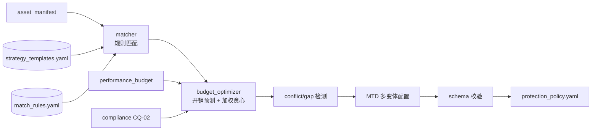

# DD-02 策略引擎详细设计（Strategy Engine）

## 文档信息

- **版本**：v1.0
- **日期**：2026-10-15
- **阶段**：S2 详细设计
- **上游**：`SRS.md` v1.2 §3.2（FR-B1…B6）、NFR-01、CQ-02、`plan/anti-rea-plan.md §3.2`、`interfaces.md` v1.1 §2.2、`schemas/protection_policy.schema.json`
- **依赖**：DD-01（输入 `asset_manifest`）
- **状态**：初稿

---

## 1. 目标与范围

把「`asset_manifest` + 预算 → `protection_policy`」设计到可编码级：策略 DSL、模板库、匹配规则、**开销预测模型**、**预算约束优化算法**、冲突/缺口告警、MTD 多变体、合规分级。不含变换执行（DD-03…）。

## 2. 组件与数据流



## 3. 接口落点

| 项 | 内容 |
| :--- | :--- |
| 方法 | `strategy.plan(manifest: AssetManifest, budget: PerformanceBudget) -> ProtectionPolicy \| Error` |
| `budget` | `{ max_overhead, target_overhead, compliance?: {crypto_strength_tier?, target_market?} }` |
| 输出 | `protection_policy.yaml`（`schemas/protection_policy.schema.json`） |
| 错误 | `E_SCHEMA_VIOLATION`、`E_BUDGET_EXCEEDED`（无法在预算内达成最低目标强度） |

## 4. 策略 DSL（FR-B1）

**模板库** `templates/strategy_templates.yaml`（YAML 可维护，新增模板无需改代码）：

```yaml
version: 1
templates:
  - id: P0-combo
    match: { sensitivity: P0 }
    strategies: [code_virtualization, white_box_crypto, non_linear_mba, adversarial_inducement]
    params: { coverage: 0.5, order: 4 }
    mtd: { enabled: true, variant_count: 8 }
  - id: P1-combo
    match: { sensitivity: P1 }
    strategies: [control_flow_flattening, mixed_boolean_arithmetic, opaque_predicates]
  - id: P2-light
    match: { sensitivity: P2 }
    strategies: [identifier_renaming, string_encryption]
  - id: P3-none
    match: { sensitivity: P3 }
    strategies: []
```

**匹配规则** `templates/match_rules.yaml`（可配置，FR-B2）：

```yaml
rules:
  - when: { sensitivity: P0, language: [c, cpp, rust] }
    use: P0-combo
  - when: { type: crypto }
    ensure: [white_box_crypto]        # 追加/保证某策略
  - when: { skip_transform: true }
    use: P3-none                      # 开源/跳过，零变换（CQ-01）
  - when: { sensitivity: P2 }
    use: P2-light
default: P3-none
```

**语义**：`when` 为字段合取条件（缺省字段=通配）；`use` 选模板；`ensure` 在匹配基础上强制追加策略。规则按**特异性排序**（条件数降序）取首个命中（FR-B2：无资产遗漏、规则可调）。

## 5. 开销预测模型（FR-B3）

对资产 `a`、策略集 `S`：

```text
overhead_pred(a) = hotness(a) * Σ_{s∈S} κ_s * base_cost(s, params)
total_overhead   = Σ_a overhead_pred(a) * runtime_share(a)   # 按运行时间占比归一
```

- `base_cost`（默认，可标定）与 `hotness`：见下表；
- `κ_s`：**标定因子**，初值 1.0，由 DD-07 的实测开销回归更新（存 `strategy_kb`），保证「预测 vs 实际偏差 ≤ 30%」（FR-B3）；
- `runtime_share`：缺省按代码规模估计；有 profile 时按实测时间占比。

| 策略 | `base_cost` | | 策略 | `base_cost` |
| :--- | :--- | :--- | :--- | :--- |
| `code_virtualization` | 0.20（×coverage） | | `opaque_predicates` | 0.03 |
| `non_linear_mba` | 0.02（×order） | | `function_boundary_perturbation` | 0.02 |
| `control_flow_flattening` | 0.08 | | `data_flow_noise` | 0.02（×noise_ratio） |
| `adversarial_inducement` | 0.04 | | `string_encryption` | 0.008 |
| `mixed_boolean_arithmetic` | 0.04 | | `identifier_renaming` | 0.004 |
| `white_box_crypto` | 0.03 | | — | — |

`hotness(a) ∈ [0.5, 1.5]`：由静态调用频率/循环深度启发式估计；有 profile 时用实测。

**防护强度模型**（用于优化目标）：`strength(S) = 1 - Π_{s∈S}(1 - eff(s))`，`eff` 见下表；组合天然获得协同增益。

| 策略 | `eff` | | 策略 | `eff` |
| :--- | :--- | :--- | :--- | :--- |
| `code_virtualization` | 0.35 | | `opaque_predicates` | 0.12 |
| `control_flow_flattening` | 0.25 | | `function_boundary_perturbation` | 0.12 |
| `non_linear_mba` | 0.22 | | `data_flow_noise` | 0.10 |
| `adversarial_inducement` | 0.20 | | `string_encryption` | 0.08 |
| `mixed_boolean_arithmetic` | 0.18 | | `identifier_renaming` | 0.05 |
| `white_box_crypto` | 0.15 | | — | — |

## 6. 预算约束优化（FR-B3）

**问题**：在 `total_overhead ≤ budget.max_overhead` 下最大化 `value = Σ_a w(sens_a) * strength(S_a)`，其中 `w: P0=1.0, P1=0.6, P2=0.25, P3=0`。属多选择背包类，采用**加权贪心 + 局部校验**：

```text
function plan(manifest, budget):
    # 1) 模板匹配（FR-B2）
    for a in manifest.assets:
        S[a] = match(a)                        # use + ensure
    # 2) 合规强制（CQ-02）
    S = applyCompliance(S, budget.compliance.crypto_strength_tier)
    # 3) 预算优化：贪心增档 → 超预算则贪心降级
    total = predictTotal(S)
    while total > budget.max_overhead:
        # 降级阶梯：reduce coverage/order → drop 最低 value/cost 策略
        (a, s, action) = argmin_value_per_cost(S, degrade_ladder)
        if action == none_removable: return E_BUDGET_EXCEEDED
        S = apply(S, a, s, action); total = predictTotal(S)
        log_degradation(a, s, action)
    # 4) 冲突 / 缺口检测（FR-B5）
    conflicts, gaps = check(S)
    # 5) MTD 多变体（FR-B4）
    S = configureMTD(S, budget)
    policy = assemble(manifest, budget, S, seed)
    validate(policy, protection_policy.schema.json)   # FR-B6
    return policy
```

**降级阶梯**（按序）：`coverage↓` → `order↓` → `noise_ratio↓` → `drop(最低 value/cost)` → `drop(次低)` …；P0 的 `code_virtualization` 与 `white_box_crypto` 为**不可移除**，仅允许降参数。
**增档路径**（预算充裕时）：按 `Δvalue/Δcost` 贪心追加，逼近 `target_overhead`（Pareto 前沿的单调逼近）。
**算法正确性思路**：value 对每资产策略集单调、预算为单一线性约束，贪心在多选择背包上是 `1/2` 近似；每一步后重算预算，保证**可行性**；`E_BUDGET_EXCEEDED` 仅在「最低可行策略集仍超预算」时触发（FR-B3 的告警 + 降级并存）。
**复杂度**：匹配 `O(A·R)`；优化每步 `O(A·S)`，步数受策略数上界 `O(A·S)`，总体 `O(A·S²)`，A 为资产数、S 为候选策略数（常数级）。

## 7. 合规分级（CQ-02）

- `crypto_strength_tier ∈ {A,B,C}` 影响 `white_box_crypto`/`non_linear_mba` 的参数与是否启用；写入 `policy.compliance`；
- 缺省由 `target_market` 映射（未定项见 OI-04，S5 完善）；本阶段提供开关与审计日志入口（保留合规审计）。

## 8. 冲突 / 缺口检测（FR-B5）

| 类型 | 例 | 处置 |
| :--- | :--- | :--- |
| 冲突 | 同一资产同时 `code_virtualization` 与不兼容的 `function_boundary_perturbation` | 去除低价值者 + 告警 |
| 顺序冲突 | 参数非法组合（如 `order>4`） | 修正到边界 + 告警 |
| 覆盖缺口 | P0 资产无任何策略 / `skip_transform` 误配 | 可读告警；P0 缺口升级为错误 |
| 参数越界 | `coverage>1` 等 | 裁剪到 Schema 范围（`E_SCHEMA_VIOLATION` 前拦截） |

## 9. MTD 多变体（FR-B4）

- 对 `mtd.enabled=true` 的资产写入 `mtd.variant_count`（1–64）与每变体 `seed` 派生规则；
- 变体差异率由 DD-03 的变换随机化实现；本层只负责配置与种子编排（保证 NFR-04：同 seed 同变体、异 seed 差异达标）。

## 10. 输出与 Schema 校验（FR-B6）

- 组装 `protection_policy`：`schema_version`、`seed`、`target`（来自 manifest.project）、`performance_budget`、`compliance?`、`assets[]`、`verification?`、`build?`；
- **每个资产必有 `strategies`**（可为空 = 显式不保护，FR-B2 无遗漏）；
- fail-fast 校验（YAML 解析后按 Schema），失败 `E_SCHEMA_VIOLATION`。

## 11. 错误处理与降级

| 情形 | 处置 |
| :--- | :--- |
| manifest 未过 Schema | `E_SCHEMA_VIOLATION`（前置，`interfaces.md §2.2`） |
| 预算内无法达成最低目标强度 | `E_BUDGET_EXCEEDED` + 给出降级选项（`e2e-scenario.md §9`） |
| 预测超预算但可降级 | 自动降级 + 告警（非错误） |
| 合规分级缺省 | 用安全缺省（较高 tier）并告警 |

## 12. 测试要点（移交 `dd-09-test-plan.md`）

| FR | 用例方向 |
| :--- | :--- |
| FR-B1 | 四档模板齐备；新增模板不改代码即生效 |
| FR-B2 | 给定 manifest 零遗漏；规则调整可改变匹配结果 |
| FR-B3 | 预测 vs 实际偏差 ≤30%；超预算自动降级并告警 |
| FR-B4 | n 变体两两差异率 ≥ 阈值；各变体功能测试全过 |
| FR-B5 | 已知冲突零漏报；缺口有可读告警 |
| FR-B6 | 产出过 Schema |
| CQ-02 | 分级配置生效、审计日志保留 |

## 13. 未决 / 风险

- **`base_cost`/`eff` 标定**：默认值需经 DD-07 实测回归校准（`κ_s`）；校准数据来源与流程在 `dd-07-evaluation.md` 明确；
- **`hotness` 估计**：无 profile 时用静态启发式，误差经 `κ_s` 吸收；若偏差超阈值，引入轻量采样 profile；
- **合规分级映射**（CQ-02 × OI-04）：目标市场清单未定（S5），当前仅打通开关与日志。
