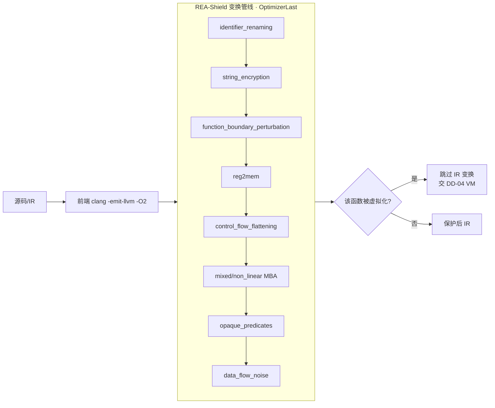

# DD-03 LLVM 变换详细设计（Transform Engine · IR 层）

## 文档信息

- **版本**：v1.0
- **日期**：2026-10-15
- **阶段**：S2 详细设计
- **上游**：`SRS.md` v1.2 §3.3.1/§3.3.4（FR-C1…C6、C11、C12）、NFR-03/04/08、`ADR.md` ADR-001/005、`poc/poc1-llvm-pass/`、`poc-plan.md §6`
- **依赖**：DD-02（输入 `protection_policy`）
- **状态**：初稿

---

## 1. 目标与范围

把 LLVM IR 层变换（CFF、MBA、不透明谓词、函数边界扰动、数据流噪声、标识符重命名、字符串加密）与变换框架（选择性、SPI、等价性验证）设计到可编码级。**不含**虚拟化（DD-04）、白盒密码（DD-06）。

## 2. 关键约束（来自 PoC-1，必须遵守）

1. **变换在优化流水线末端执行**（`OptimizerLast`）：否则被 `SimplifyCFG` 等还原（ADR-001）；
2. **CFF 前必须 `reg2mem`**：CFF 使派发块可绕过任意块，破坏跨块 SSA 支配；`reg2mem` 先把跨块值降级到内存；
3. **入口块不作派发目标**，仅写入初始状态；
4. **不支持端子**（`invoke/callbr/indirectbr/switch/EH` 端子）→ 跳过该函数（v1.0 边界）；
5. 验证以**最终二进制**为准：`clang -S -emit-llvm` 文本不含 `OptimizerLast` 效果。

## 3. 组件与 Pass 管线



**管线顺序与理由**

| 次序 | Pass | 理由 |
| :--- | :--- | :--- |
| 1 | identifier_renaming | 先改符号名，避免后续分析依赖原语义名 |
| 2 | string_encryption | 常量串尽早加密，防止后续把明文串下沉/合并；同 pass 内先做**常数编码**（可疑整型立即数进本函数常量池，运行期解码；开关 `ANTI_REA_CONST_ENCODE`，默认开） |
| 3 | function_boundary_perturbation | 拆分/合并改变 CFG，须在平坦化前 |
| 4 | **reg2mem** | CFF 前置（约束 2） |
| 5 | control_flow_flattening | CFG 重构 |
| 6 | MBA | 作用于平坦化后的表达式 |
| 7 | opaque_predicates | 在调度器/分支上加恒真守卫 |
| 8 | data_flow_noise | 最后注入冗余数据操作 |
| — | （虚拟化函数） | 交 DD-04，IR 层变换**跳过**（避免与 VM 冲突） |

**优先级**：若 `policy` 同时含 `code_virtualization` 与 IR 变换，则对**被 VM 覆盖的函数**只做 VM；IR 变换施加于其余白名单代码（见 §5.5）。

## 4. CFF 详细设计（FR-C1）

### 4.1 块提取

```text
blocks = []
for BB in F (除入口):
    if terminator(BB) ∈ 不支持集:            # invoke/callbr/indirectbr/switch/EH
        return SKIP(F)                        # v1.0：跳过并记录
    blocks.append(BB)
```

### 4.2 调度器构造

- 入口：分配 `cff.state`（Alloca），写入**初始状态**，`br dispatch`；
- 派发块：`switch(load state)`，每个基本块一个 case；`default → cff.unreachable`；
- 每个参与块：端子改写为「写后继状态 → `br dispatch`」。

### 4.3 状态编号与**状态重排**（seed 驱动）

PoC 用顺序号 `1..n`；DD-03 升级为**随机置换**：`id(BB) = π_seed(index)`，其中 `π` 由 `seed` 生成（NFR-04/08）。进一步可选**状态编码**：`state_enc(x) = a*x + b (mod 2^32)`（`a` 奇），使相邻块的 case 常量不呈现顺序结构。

```text
function cff(F, seed):
    demotePHIsToStack(F)                       # 安全网（opt 单跑路径）
    blocks = extract(F)
    perm   = randomPermutation(|blocks|, seed)
    state  = entry.alloca(i32); entry.store(enc(perm[entry])); entry.br(dispatch)
    dispatch: switch(load state) cases enc(perm[i]) -> blocks[i]; default -> unreachable
    for bb in blocks ∪ {entry}:
        rewriteTerminator(bb, enc∘perm)        # 无条件/条件分支 -> store + br dispatch
```

### 4.4 边界与降级

- 大函数（块数 > `CFF_MAX_BLOCKS`，缺省 256）：可采用**多级调度器**（dispatcher tree）或跳过；v1.0 缺省跳过 + 告警；
- 含异常处理的函数：v1.0 跳过（后续可只平坦化 non-landingpad 区域）。

**复杂度**：`O(B + E)`（B 块、E 边）。**正确性思路**：仅重写端子并插入派发，配 `reg2mem` 保证 SSA 有效 ⇒ 语义保持（由 §8 差分测试复核）。

## 5. MBA 详细设计（FR-C2）

### 5.1 恒等式库（节选）

| 恒等式 | 形式 |
| :--- | :--- |
| 加-与-异或 | `x + y = (x ^ y) + 2*(x & y)` |
| 加-或-与 | `x + y = (x | y) + (x & y)` |
| 减 | `x - y = x + ~y + 1` |
| 异或 | `x ^ y = (x | y) - (x & y)` |
| 乘（多项式 MBA） | `x * y = (x & y) * ((x | y) - (x & y)) + (x & ~y) * (y & ~x)` |
| 与 | `x & y = (x + y - (x ^ y)) / 2` |

### 5.2 树展开

- **线性 MBA（order 1–2）**：嵌套上式，展开为多层；
- **非线性/多项式 MBA（order 3–4）**：引入乘项，表达式规模显著增长；
- 由 `params.order`（1–4）控制；设表达式规模上限 `MBA_MAX_NODES`，超限则降阶并告警。

```text
function mba(expr, order, seed):
    depth = min(order, floor(log2(MBA_MAX_NODES / size(expr))))
    choose identities by seed; rewrite bottom-up to depth
    return rewritten
```

### 5.3 等价性（SMT）

- 每条重写生成等价性义务：`assert (orig != rewritten)`，用 **Z3 位向量理论**求解；
- `unsat` ⇒ 等价，接受；`sat`（反例）⇒ 丢弃该重写并回退（记录）。
- 复杂度：随表达式规模增长；通过 `MBA_MAX_NODES` 与阶数上限约束。

## 6. 不透明谓词详细设计（FR-C3）

- **恒真式构造**：如 `(x*(x+1)) & 1 == 0`、`(x*x - x) % 2 == 0`；
- **污点保证**（关键）：
  1. **语义中立**：谓词只守卫控制流，其操作数**不参与**真实数据计算（避免污染数据流）；
  2. **抗折叠**：操作数取自**运行期不可静态证明**的值（如初始化于运行期的全局 `opaque_seed`、`volatile` 读、或其值由 `a ^ b`（a、b 运行期）导出），保证 `SimplifyCFG`/常量折叠/死代码消除**无法**消除；
  3. **恒真/恒假可证**：对分析者不透明，但对编译器保持恒真（或恒假）语义。
- **插入点**：CFF 派发块、条件分支、循环头；数量受 `budget` 约束（防膨胀）。

## 7. 其余 IR 变换

| FR | 设计要点 |
| :--- | :--- |
| FR-C4 函数边界扰动 | 拆分（按基本块聚类）/合并（`always_inline` 候选）；改变反编译器函数识别数；语义不变 |
| FR-C5 数据流噪声 | 注入无副作用冗余数据操作（`noise_ratio` 控制密度）；不改变可观测行为；开销入预算 |
| （重命名） | 符号级重命名，配合调试信息剥离 |
| （字符串加密） | 常量串异或/查表编码 + 运行期解码桩 |

## 8. 等价性验证（FR-C12）

| 层级 | 手段 | 适用 |
| :--- | :--- | :--- |
| 表达式级 | Z3 位向量等价（§5.3） | MBA、不透明谓词 |
| 变换级 | 构造性论证 + 结构不变量（CFF/reg2mem） | CFF、边界扰动 |
| 端到端 | **差分测试**：原始 vs 保护产物在相同输入下输出一致；单元测试 100% 通过（NFR-03） | 全部 |
| 钩子 | 可选触发测试套件做语义回归；失败按 `policy.verification.abort_on_failure` 回滚/中止 | FR-C12 |

## 9. 变换框架

### 9.1 选择性变换（FR-C6）

- `engine.protect` **仅**处理 `policy` 白名单（`strategies` 非空且 `skip_transform=false`）；
- 非名单文件 / 开源资产**字节级零改动**，由 DD-09 的字节比对用例验收。

### 9.2 插件 SPI（FR-C11，ADR-005）

- 新变换经 `SPI_VERSION` + 能力声明注册，核心引擎不改；
- 宿主校验插件 `SPI_VERSION` 兼容性，不兼容拒载（`E_PLUGIN_INCOMPATIBLE`）。

## 10. 可复现与随机性（NFR-04/08）

- 全部随机（状态置换 `π`、恒等式选择、噪声注入）由 `seed` 派生；同 `输入指纹 + seed + 引擎版本` ⇒ 逐位一致；
- 关闭随机开关 ⇒ 固定缺省序列（确定性）。

## 11. 错误处理

| 情形 | 处置 |
| :--- | :--- |
| 命中不支持端子 / 超大函数 | 跳过该函数 + 告警（非错误） |
| MBA 等价性反例 | 丢弃该重写并回退（记录） |
| 变换破坏语义（差分失败） | `E_TRANSFORM_FAILED`，按 FR-C12 回滚该资产或中止 |
| 插件版本不兼容 | `E_PLUGIN_INCOMPATIBLE` |

## 12. 测试要点（移交 `dd-09-test-plan.md`）

| FR | 用例方向 |
| :--- | :--- |
| FR-C1 | CFF 后差分测试全过；反编译 CFG 复杂度指标显著提升 |
| FR-C2 | MBA 1–4 阶等价性 Z3 全过；规模随阶数可控 |
| FR-C3 | 谓词不被常量折叠/DCE 消除；语义不变 |
| FR-C4/C5 | 语义不变；可观测指标（函数数变化 / 开销）符合预期 |
| FR-C6 | 非白名单文件字节级零改动 |
| FR-C11 | 新增示例变换免改核心引擎 |
| FR-C12 | 钩子可触发；失败回滚/中止 |

## 13. 未决 / 风险

- **EH / invoke 支持**：v1.0 跳过含 EH 函数，覆盖受限；后续版本评估部分平坦化；
- **MBA 规模控制**：高阶梯爆炸需 `MBA_MAX_NODES` 硬约束 + Z3 时限；
- **反分析对抗**：不透明谓词的抗折叠强度随编译器版本变化，需在 DD-09 中以「多优化级别」回归；
- **虚拟化互斥**：VM 与 IR 变换的边界在 DD-04 收口。
