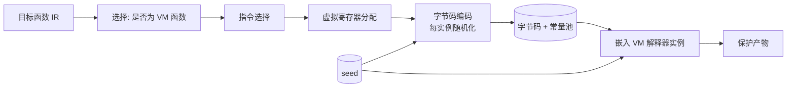

# DD-04 虚拟化引擎详细设计（Transform Engine · VM）

## 文档信息

- **版本**：v1.0
- **日期**：2026-10-15
- **阶段**：S2 详细设计
- **上游**：`SRS.md` v1.2 §3.3.2（FR-C7/C8）、`plan/anti-rea-plan.md §3.3.2`、`ADR.md` ADR-002、`interfaces.md` §2.3
- **依赖**：DD-02（coverage/预算）、DD-03（与 IR 变换的边界）
- **状态**：初稿

---

## 1. 目标与范围

设计**自研虚拟化引擎**（ADR-002）：自定义 ISA 规范、IR→字节码编译算法、解释器结构与反调试陷阱、覆盖率控制。范围限 x86_64 / ARM64 产物（RISC-V 属 Won't，SRS §2.2）。

## 2. 架构与流程



**流程**：`IR → 指令选择 → 寄存器分配 → 编码（seed 随机化）→ 与解释器实例链接`。字节码**平台中立**；解释器**每目标架构一份**；每实例 opcode 映射/寄存器分配/密钥**随机化**（FR-C7）。

## 3. 自定义 ISA 规范（FR-C7）

### 3.1 机器模型

- **虚拟寄存器**：16 个 64-bit 寄存器 `v0..v15`（`v14`=栈指针、`v15`=返回地址约定）；浮点经 `v` 对表示（软浮点）或后缀 `f` 指令；
- **内存**：线性地址空间 + 显式虚栈；越界访问触发 VM 陷阱；
- **状态标志**：`Z/N/C/V`（按需）；VM 自带 `vm_pc`、`vm_sp`。

### 3.2 指令编码（**变长 + 每实例随机化**）

```text
字节码单元:  [opcode:1B][operands:0..8B]        # 变长
opcode_encoded = P_inst(opcode_real) XOR K_inst # 每实例置换 P + 密钥 K
operand_encoded = operand_real XOR K_operand    # 操作数掩码
```

- 指令集分类（节选）：`MOV/LD/ST/ADD/SUB/AND/OR/XOR/SHL/SHR/MUL/DIV/MOD/CMP/JMP/JZ/JNZ/CALL/RET/...`；
- **每实例随机化**：opcode 空间置换 `P_inst`、操作数掩码、`vm_pc` 步进编码均派生自 `seed`（不同实例字节码不通用，抗重放/跨实例移植）；
- **变长**：操作数个数随指令变化，打破定长模式识别。

### 3.3 调用约定

- **VM↔native**：入口桩（stub）把 native ABI 参数搬入 `v0..`，返回经 `v0`；
- **VM 内部调用**：VM 栈帧（返回地址 + 保存寄存器），`CALL/RET` 使用**编码后的相对偏移**。

### 3.4 异常语义

- **VM 级陷阱**：非法 opcode、除零、越界 → 触发 VM handler；
- **语义保持要求**：被虚拟化代码的**原生异常行为**必须保持（NFR-03）；对含复杂 EH 的函数，v1.0 **不虚拟化**（与 DD-03 一致），避免语义偏差。

## 4. 字节码编译算法

```text
function compile(F, seed):
    regs = linearScanAllocate(F)            # SSA -> 虚拟寄存器（含溢出到虚栈）
    code = []
    for I in linearize(F):                  # 逆后序/支配序
        code += select(I)                   # 指令选择（IR op -> VM op）
    code = encode(code, seed)               # 逐实例置换 + 掩码
    pool = encodeConstantPool(F, seed)      # 常量/字符串编码池
    return Bytecode(code, pool, meta(seed, version))
```

- **指令选择**：IR 算术/逻辑/内存/控制流按一一或一对多映射；整数宽窄按需截断/扩展；
- **控制流**：`br/condbr` → `JMP/JZ/JNZ`（相对偏移编码）；`switch` → 跳转表或链式比较；
- **常量池**：常量与字符串加密存储，运行期按需解码；
- **复杂度**：`O(N)`（N 条 IR 指令），寄存器分配 `O(N log N)`（线性扫描）。

## 5. 解释器结构与反调试陷阱

- **分派循环**：取指 → 解码 → 执行；可选**线程化分派**（computed-goto）提性能；分派表亦经编码；
- **解释器自身的混淆**：对解释器函数再施 DD-03 的 MBA/不透明谓词，阻止攻击者通过分析 VM 反推被保护代码（`plan §3.3.2`）；
- **反调试陷阱**（可配置）：
  - `ptrace`/调试器检测、时序异常检测；
  - 字节码/常量池**完整性自校验**（篡改即触发陷阱）；
  - 命中陷阱后的行为**不透明**（可走诱饵路径），但**不得**破坏正常功能路径的正确性。

## 6. 覆盖率控制（FR-C8）

- `params.coverage ∈ [0,1]` = 被虚拟化的白名单代码比例；
- **选择策略**：在 `policy` 指定可虚拟化集合内，按 `sensitivity × hotness` 降序选取，直到达到覆盖目标；
- **误差**：实际覆盖率与配置误差 ≤ 5%（FR-C8），以「被虚拟化指令数 / 候选指令数」度量；
- 受 DD-02 预算约束（VM 开销最大，缺省仅 P0）。

## 7. 多架构

| 目标 | 字节码 | 解释器 |
| :--- | :--- | :--- |
| linux-x86_64 | 同一套（平台中立） | x86_64 版 |
| linux-arm64 | 同一套 | ARM64 版 |
| windows-x64 | 同一套 | x64 版 |

## 8. 与 IR 变换的边界（衔接 DD-03）

- 被 VM 覆盖的函数**跳过** IR 层 CFF/MBA/不透明谓词（避免双重变换冲突）；
- **VM 解释器本身**可施加 IR 变换（作为 DD-03 白名单的一部分）；
- 同一函数不得同时出现在「VM 集合」与「IR 变换集合」（由 DD-02 的 policy 保证或由引擎去重）。

## 9. 错误处理

| 情形 | 处置 |
| :--- | :--- |
| 含复杂 EH/不支持的 IR 构造 | 不虚拟化该函数 + 告警（回退 IR 变换） |
| 覆盖率无法在预算内达成 | 降 coverage 并告警（FR-C8） |
| 字节码自校验失败（运行期） | VM 陷阱（不透明行为） |
| 编译/编码失败 | `E_TRANSFORM_FAILED` |

## 10. 测试要点（移交 `dd-09-test-plan.md`）

| FR | 用例方向 |
| :--- | :--- |
| FR-C7 | 虚拟化后功能正确（差分测试全过）；每实例 opcode 映射与寄存器分配随机化（跨实例字节码不通用） |
| FR-C8 | 实际覆盖率与配置误差 ≤5% |
| NFR-03 | 虚拟化产物单测 100% 通过、差分无偏差 |
| NFR-05 | x86_64 / ARM64 产物均可运行 |

## 11. 未决 / 风险

- **性能**：VM 开销可达 2–5×（`plan §3.3.2`），须严格受预算与覆盖率约束；实测与预测偏差经 DD-02 的 `κ_s` 校准；
- **异常/复杂 IR**：v1.0 覆盖受限，需在 DD-09 记录覆盖边界；
- **反调试合规**：反调试陷阱**不得**妨碍正常功能与 EDR 兼容（NFR-10），行为需可审计。
