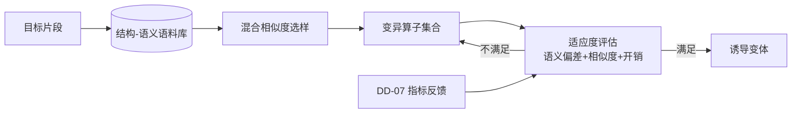

# DD-05 对抗性诱导详细设计（Transform Engine · Adversarial Inducement）

## 文档信息

- **版本**：v1.0
- **日期**：2026-10-15
- **阶段**：S2 详细设计
- **上游**：`SRS.md` v1.2 §3.3.3（FR-C9）、FR-E6（LLM 功能判断指标）、`plan/anti-rea-plan.md §3.3.3`
- **依赖**：DD-02（策略选型/预算）、DD-07（指标反馈）
- **状态**：初稿

---

## 1. 目标与范围

设计**对抗性诱导生成器**（FR-C9）：生成**功能保持但语义误导**的代码/二进制变体，使 LLM 逆向工具的**功能判断偏移**、二进制相似度下降，同时体积/开销受控。参考 SemAder（结构-语义联合诱导）与 Acoda（遗传算法迭代）。

## 2. 方案概览



**三阶段**（SemAder 映射）：① 语料库构建 → ② 混合相似度驱动选样 → ③ 语义融合/变异（GA 迭代）。

## 3. 语料库构建（FR-C9）

- **结构标注**：控制流结构标签（顺序/分支/循环/递归/异常）、嵌套深度、支配关系特征；
- **语义特征**：算法类别、数据依赖模式、常量/IO 模式；
- **来源**：目标片段自身 + 内置模板库（避免引入第三方代码，遵守 CQ-01）；
- **索引**：`(结构向量, 语义向量)` 双索引，支持「结构相近、语义背离」检索。

## 4. 相似度度量

| 度量 | 用途 | 说明 |
| :--- | :--- | :--- |
| **结构相似度** `sim_s` | 选样：结构相近 | CFG/AST 结构编辑距离（归一化到 [0,1]） |
| **语义相似度** `sim_m` | 选样：语义背离 | 基于语义特征向量/嵌入的余弦距离 |
| **二进制相似度** `sim_b` | 验收：相似度下降 | 由 DD-07 的检测器评分（目标降至 ≈0.51，接近随机） |

选样策略：优先选 `sim_s` 高而 `sim_m` 低的语料（结构相近但语义不同），最大化误导潜力。

## 5. 变异算子集合

| 算子 | 说明 | 参考 |
| :--- | :--- | :--- |
| `constant_externalize` | 常量外部化到不透明来源 | SemAder |
| `context_semantic_aug` | 上下文感知语义增强（植入误导性命名/注释/结构） | SemAder |
| `try_except_wrap` | 有效代码藏入 `except`/异常路径，诱导条件误判 | Acoda |
| `eos_token_inject` | 在可被 LLM 当作文本读取的位置植入「结束标记」样式内容，诱导生成提前终止 | Acoda（**受 §9 约束**） |
| `ga_crossover` | 语料交叉繁殖 | Acoda |
| `ga_mutate` | 结构与常量微扰 | Acoda |

**约束**：所有算子必须**功能保持**（差分测试通过，NFR-03），且不引入外部依赖。

## 6. 适应度函数（GA 驱动）

```text
fitness = w1 * semantic_deviation        # 越大越好（诱导 LLM 功能判断偏移；目标 ~0.77）
        + w2 * (1 - bin_similarity)      # 越大越好（相似度下降；目标 ~0.51）
        - w3 * size_growth_penalty       # 体积增长（目标 ≤12.7%）
        - w4 * overhead_penalty          # 运行开销（目标 ≤8.8%）
        s.t. functional_pass == true     # 硬约束：功能保持
```

- 权重 `w1..w4` 可配置；默认按 SemAder/Acoda 参考值设；
- `semantic_deviation`、`bin_similarity` 取自 DD-07 的攻击模拟/检测指标（**反馈闭环**）；
- GA：种群/代数/交叉率/变异率见 DD-08（自适应引擎复用同一框架）。

## 7. 与策略/预算集成（衔接 DD-02）

- 触发：`policy` 含 `adversarial_inducement`（缺省 P0）；
- 开销：DD-02 中 `base_cost=0.04`、`eff=0.20`；体积/开销受 `max_overhead` 约束；
- 仅在预算允许时启用 GA 迭代，否则退化为单轮算子应用。

## 8. 复杂度

- 单轮变异：`O(N)`（N 片段规模）；
- GA：`O(G · P · C_eval)`（G 代数、P 种群、`C_eval` 为评估成本，通常取 DD-07 指标的缓存/代理）。

## 9. 安全与合规约束

- **`eos_token_inject` 等针对 LLM 输出层的手法**：仅在**自有产物**、且明确用于「诱导 AI 逆向工具误判」时启用；不得用于生成欺骗最终用户或规避安全软件的内容（NFR-10 / CQ-04）；
- 诱导变体**不得**改变程序的真实行为（差分测试把关）；
- 全部生成在**本地**完成（NFR-06）。

## 10. 错误处理

| 情形 | 处置 |
| :--- | :--- |
| 变异破坏功能 | 丢弃该变体（硬约束），重试或退化 |
| 体积/开销超预算 | 拒绝该变体，回到 GA 选择 |
| 无可用语料 | 退化为单轮算子 + 告警 |

## 11. 测试要点（移交 `dd-09-test-plan.md`）

| FR | 用例方向 |
| :--- | :--- |
| FR-C9 | 功能测试全过；LLM 功能判断出现显著偏差；体积/开销增长受控 |
| FR-E6 | `semantic_deviation` / `bin_similarity` 指标被正确采集并回灌适应度 |
| NFR-03 | 差分测试无行为偏差 |

## 12. 未决 / 风险

- **指标依赖**：适应度依赖 DD-07 的攻击模拟指标，若 LLM 不可用则 GA 退化为静态代理度量；
- **泛化性**：诱导效果依模型而变（同 ADR-004），需在 DD-08 的多 LLM 协议下评估；
- **合规审查**：`eos_token_inject` 等手法须经合规评审（CQ）后方可在默认策略中启用。
