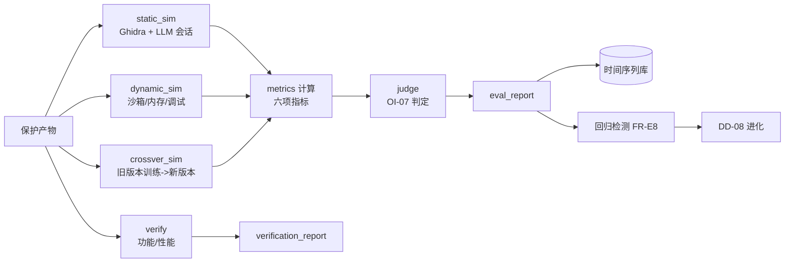

# DD-07 评估层详细设计（Evaluation & Verification）

## 文档信息

- **版本**：v1.0
- **日期**：2026-10-15
- **阶段**：S2 详细设计
- **上游**：`SRS.md` v1.2 §3.5（FR-E1…E8）、NFR-02/03、CQ-05、`schemas/verification_report.schema.json`、`schemas/eval_report.schema.json`、`decisions/OI-07-rea-success-criteria.md`
- **依赖**：DD-03…DD-06（评估对象）、DD-08（反馈消费方）
- **状态**：初稿

---

## 1. 目标与范围

设计评估验证层：功能保持与性能基准（`verify`）、攻击模拟与六项指标（`attack_sim`）、**指标采集口径与计算式**、**基准题库 ground truth 设计**、时间序列存档与回归检测。判定口径**引用 OI-07 决策**。

## 2. 组件与数据流



## 3. 接口落点

| 方法 | 输入 | 输出 | 错误 |
| :--- | :--- | :--- | :--- |
| `evaluate.verify` | `artifacts`、`test_cmd` | `verification_report` | `E_VERIFY_FAILED` |
| `evaluate.attack_sim` | `artifacts`、`config{ghidra?,llm?,session?,budget?,mode?}` | `eval_report` | `E_LLM_UNAVAILABLE` |

## 4. 攻击模拟编排（FR-E3/E4/E5）

| 通道 | 编排 | 输出 |
| :--- | :--- | :--- |
| **静态** | Ghidra Headless（**PyGhidra**，批量反编译，成功率 ≥95%）→ 反编译文本送入**独立会话** LLM 做语义恢复 | 函数名恢复、功能判断、会话消耗 |
| **动态** | 沙箱运行受保护代码；尝试内存转储 / 调试附着 | 动态攻击结果、密钥暴露迹象 |
| **跨版本** | 用**旧版本**产物与结果"训练"/预热会话，再攻击新版本 | 跨版本复用效果报告 |

- **独立会话**：每个目标产物一个新会话（无历史/无跨目标迁移），系统提示固定中性模板（OI-07 §5）；
- **LLM 出站控制**（CQ-05）：调用外部 LLM 必须**显式开启**；未开启 → 强制 `static_only`（§8）；
- **采样**：验收（AT）全量；CI 回归（FR-E8）抽样。

## 5. 六项指标：采集口径与计算式（FR-E6）

设基准题库 ground truth 提供：函数名 `name*`、功能类别 `cat*`、关键秘密 `secret*`、漏洞 `vuln*`（含位置）。

| 指标 | 字段 | 计算式 | 目标 |
| :--- | :--- | :--- | :--- |
| Token 消耗倍数 | `token_ratio` | `token(protected, session) / token(baseline, session)` | ≥100x→500x |
| 分析时间倍数 | `time_ratio` | `time(protected) / time(baseline)`（wall-clock） | ≥10x |
| 函数名恢复准确率 | `name_recovery_accuracy` | `|{f: norm(recovered[f])==norm(name*[f])}| / |F|` | ≤0.20 |
| 功能判断准确率 | `function_judgement_accuracy` | `|{f: judged_cat[f]==cat*[f]}| / |F|` | ≤0.30 |
| 漏洞发现率 | `vuln_discovery_rate` | `|{v: 被正确发现}| / |vuln*|` | ≤0.10 |
| 二进制相似度 | `bin_similarity` | 相似度检测器（BinDiff/Asm2Vec）评分 | ≤0.55 |
| 会话上下文消耗率 | `session_context_used_ratio` | `used_tokens / W`（OI-07 §5） | ≥0.90 未成功→通过 |

- `baseline` / `protected` 两个 `measurement` 分别记录 `token_usage`、`analysis_time_sec`（Schema 已定义）；
- **同协议对比**：baseline 与 protected 使用**同一模型、同一提示模板、同一采样**（差值才可归因于保护）；
- 全部指标写入 `eval_report.metrics`，并落**时间序列库**（见 §7）。

## 6. 基准题库 ground truth 设计（FR-E7 支撑）

**题库要求**：许可证干净（CQ-01）、构建确定（可复现）、规模适中、覆盖 C/C++/Rust（含 P0–P3 资产与已知漏洞）。

**ground truth 结构（新增数据契约 `schemas/benchmark.schema.json`，本阶段定义）**：

```yaml
id: bench-crypto-001
language: c
build: { system: cmake, cmd: "cmake -B build && cmake --build build" }
targets:
  - symbol: "aes_encrypt_block"
    name: "aes_encrypt_block"
    category: crypto            # 用于功能判断
    secrets: ["round_key_schedule"]
    vulns: []                   # 或无
  - symbol: "check_license"
    name: "verify_license"
    category: license_check
    secrets: ["license_master_key"]
    vulns: [{ id: "CWE-798", location: "src/lic.c:42" }]
ground_truth_version: "1.0"
```

- **判分器**：对 `name_recovery` 用规范化匹配；对 `function_judgement` 用类别比对；对 `vuln` 用位置+类型比对；判分器**固定、可复现**，与调用 Agent 无关（OI-07 §3）；
- 题库与 ground truth 版本化，随 `run_id` 记录（NFR-04）。

## 7. 时间序列存档（FR-E6）

- 存储：轻量嵌入式（缺省 **SQLite**；可选 Influx），表 `metrics(run_id, ts, strategy_hash, model, token_ratio, …, verdict)`；
- 用途：趋势追踪、DD-08 进化输入、FR-E8 回归对比。

## 8. 降级模式（`static_only`）

- 触发：`E_LLM_UNAVAILABLE`、CQ-05 未授权出站、超时/限额；
- 行为：仅采集**静态可测**指标（`name_recovery_accuracy`、`function_judgement_accuracy`、`bin_similarity`），`token_ratio/time_ratio/session_context_used_ratio/rea_success` 标**未测量**；
- 判定：按 OI-07 §8 的静态阈值；`verdict.reasons` 标注「未执行 LLM 会话判定」。

## 9. 判定

- 逐模型、逐目标会话按 `OI-07` §6 判定；多模型**保守聚合**（任一模型成功即不通过）；
- 结果写入 `eval_report.verdict`。

## 10. 回归检测（FR-E8）

```text
on strategy_change:
    run attack_sim on 基准抽样（缺省 top-k P0 资产）
    if any metric 退化超过阈值: 告警 + 触发 DD-08 弱点记录
```

## 11. 复杂度 / 成本

- 每次会话消耗**一个完整上下文预算**（OI-07 §10），故用于抽样验收；
- `verify`：与目标工程测试套件规模线性；
- 指标计算：`O(|F| + |vuln| + |assets|)`。

## 12. 错误处理

| 情形 | 处置 |
| :--- | :--- |
| 功能/性能验证失败 | `E_VERIFY_FAILED`（退出码 2，定位到资产） |
| Ghidra 反编译失败率超阈 | 告警 + 记录（不中止） |
| LLM 不可用 | 降级 `static_only`（§8）或 `E_LLM_UNAVAILABLE` |
| 未授权出站 | 强制 `static_only`（CQ-05），不静默出站 |

## 13. 测试要点（移交 `dd-09-test-plan.md`）

| FR | 用例方向 |
| :--- | :--- |
| FR-E1 | 受保护产物测试 100% 通过；差分 fuzz 无偏差 |
| FR-E2 | 逐资产开销报告；超预算告警 |
| FR-E3 | 批量反编译成功率 ≥95%；产出评分；会话消耗率记录 |
| FR-E4 | 动态攻击结果纳入指标 |
| FR-E5 | 跨版本攻击效果报告 |
| FR-E6 | 指标齐全并落时间序列库 |
| FR-E7 | json/md/html 三格式内容一致 |
| FR-E8 | 退化即告警 |

## 14. 未决 / 风险

- **题库建设**：ground truth 质量直接决定指标可信度；需在 S3 前完成首批题库（DD-09 收口）；
- **相似度检测器选型**（BinDiff vs Asm2Vec）：影响 `bin_similarity` 口径，需在 S3 评估（ADR-006 适配层隔离，锁版本）；
- **会话成本**：全量验收成本高，需明确抽样方案（DD-09）。
