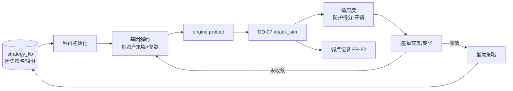

# DD-08 自适应引擎详细设计（Adaptive Strategy Engine）

## 文档信息

- **版本**：v1.0
- **日期**：2026-10-15
- **阶段**：S2 详细设计
- **上游**：`SRS.md` v1.2 §3.6（FR-F1…F4）、`ADR.md` ADR-004/005、`poc/poc3-deap/`、`poc-plan.md §6`
- **依赖**：DD-07（评估指标反馈）、DD-02（策略/预算）
- **状态**：初稿（PoC-3 已验证进化循环）

---

## 1. 目标与范围

设计**以 AI 对抗 AI 并持续进化**的引擎：策略基因编码、种群与进化参数、适应度（消费 DD-07 指标）、多 LLM 探测协议与跨模型聚合、弱点记录与策略调整、策略沉淀与迁移。PoC-3 已验证「DEAP 进化循环 + 不劣化 + 导出合规策略」。

## 2. 方案概览



## 3. 策略基因编码（与 PoC-3 一致）

- **表型**：对每个资产，`{selected_strategies, params}`；
- **基因型**：实数向量，每资产 `11`（策略开关，`>0.5` 选中）+ `4`（`coverage, order, noise_ratio, flatten_depth`）= 15 位；`GENOME_LEN = 15 × |assets|`；
- **解码**：`decode(individual) → [(asset, selected, params)]`；参数按 Schema 边界（`order∈1..4`、`coverage∈[0,1]`）映射；
- **合法性**：策略适用性由 `META[].applies`（资产类型）约束，不适用即负贡献（防乱堆）。

## 4. 种群与进化参数

| 参数 | 缺省 | 说明 |
| :--- | :--- | :--- |
| 种群 `POP` | 60 | PoC-3 |
| 代数 `NGEN` | 25 | PoC-3；可按预算调 |
| 交叉率 `CXPB` | 0.6 | 两点交叉 |
| 变异率 `MUTPB` | 0.3 | 高斯扰动 `σ=0.15`，逐位 `p=0.1` |
| 选择 | 锦标赛 `k=3` | — |
| 精英 | HallOfFame(1) 保留 | 保证不劣化 |

## 5. 适应度函数

```text
fitness(individual) = WEIGHT_STRATEGY * Σ_asset w(sens) * noisyOR(selected)
                    - [ MU_OVERHEAD * overhead
                      + LAMBDA_OVERHEAD * max(0, overhead - budget)^2 ]   # 二次惩罚
```

- `noisyOR(selected) = 1 - Π(1 - eff(s))`（边际递减，同 DD-02 强度模型）；
- `w(sens)`、`eff`、`overhead` 与 DD-02 一致；参数调制（coverage/order/depth/noise）与 PoC-3 同式；
- **代理 → 真实**：PoC-3 用代理模型；**生产**把 `META.base`/`eff` 替换为 **DD-07 实测指标**（`function_judgement_accuracy`、`rea_success`、`token_ratio`）回填，实现闭环；
- **硬约束**：`functional_pass == true`（NFR-03）。

## 6. 多 LLM 探测协议与跨模型聚合（FR-F1）

```text
function multiModelEval(artifact, models):
    results = {}
    for m in models:                       # 运行环境可用模型，≥2 时并行
        results[m] = DD-07.attack_sim(artifact, model=m)   # 各自独立会话
    aggregate = {
        pass: all(r.verdict.pass for r in results.values()),   # 保守聚合（OI-07 §7）
        metrics: {m: r.metrics for m, r in results.items()},
        generalization: variance(指标 across models)
    }
    return aggregate
```

- **并行**：存在 ≥2 个可用模型时并行评估；结果可比较（FR-F1）；
- **跨模型泛化性**：指标方差作为策略稳健性输入（方差大 → 对模型敏感，降低置信）。

## 7. 弱点记录与策略调整（FR-F2）

- 弱点判定：某资产在 `attack_sim` 中被成功还原（`rea_success=true`）或指标超目标；
- 记录：`weakness_db(asset, model, metric, evidence, suggested_fix)`；
- 调整：给出「一键执行」的策略变更（如提升 coverage/order、追加对抗诱导），执行后**指标不回退**（FR-F2），否则回退（FR-F3 不劣化）。

## 8. 策略沉淀与迁移（FR-F4）

- **入库**：有效策略（`verdict.pass=true` 且不劣化）连同其特征（语言/资产类型分布/预算）写入 `strategy_kb`；
- **迁移推荐**：对相似项目（语言/资产类型/规模相似度）推荐历史有效策略作为进化初值，加速收敛。

## 9. 与 PoC-3 的衔接（证据）

- PoC-3 ✅：DEAP 进化（fitness `-0.4603 → 1.2203`，**不劣化**），导出 `best_policy.{json,yaml}` 通过 `protection_policy.schema.json` 校验；
- 生产化差异：适应度由代理模型换为 DD-07 实测；新增多模型协议、弱点库、迁移。

## 10. 复杂度

- 每代 `O(POP × |assets| × |strategies|)`；总 `O(NGEN × POP × …)`；
- 真实评估成本由 DD-07 会话决定 → 采用**代理适应度 + 周期真实评估**（少样本）控制成本。

## 11. 错误处理

| 情形 | 处置 |
| :--- | :--- |
| 指标数据缺失（LLM 不可用） | 退化用静态代理度量；标注 |
| 进化后劣化 | 回退到上一代最优（精英保留，FR-F3） |
| `strategy_kb` 不可用 | 冷启动（内置模板做初值） |
| 导出策略不合规 | `E_SCHEMA_VIOLATION`（阻断沉淀） |

## 12. 测试要点（移交 `dd-09-test-plan.md`）

| FR | 用例方向 |
| :--- | :--- |
| FR-F1 | ≥2 模型时并行评估；结果可聚合比较 |
| FR-F2 | 弱点入库；调整可一键执行；调整后指标不回退 |
| FR-F3 | 完成进化循环；进化后防护得分不劣化 |
| FR-F4 | 有效策略入库；相似项目获迁移推荐 |

## 13. 未决 / 风险

- **真实评估成本**：全真实适应度不可行，需确定「代理 + 周期实测」的采样预算（DD-09）；
- **过拟合**：对特定模型进化的策略可能不泛化，靠多模型协议与泛化方差约束（FR-F1）；
- **PoC-3 模型参数**（base/overhead）为占位，须由 DD-07 校准（与 DD-02 `κ_s` 同步）。
