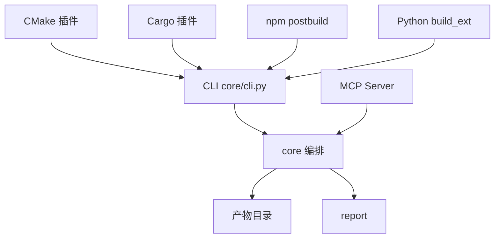

# DD-10a（补充）构建集成与产物管理详细设计（Build Integration · CLI/插件/MCP/产物）

## 文档信息

- **版本**：v1.0
- **日期**：2026-10-15
- **阶段**：S2 详细设计（补 DD-01…DD-09 未覆盖的 FR-D1…D7、FR-G1…G3）
- **上游**：`SRS.md` v1.2 §3.4（FR-D1…D7）、§3.7（FR-G1…G3）、§4.1/§4.2、`HLD.md` v1.1 §8、`interfaces.md` v1.1 §3/§4
- **状态**：初稿

---

## 1. 目标与范围

把「把 REA-Shield 嵌入构建/CI」与「产物/报告管理」设计到可编码级：CLI、CMake/Cargo/npm/Python 插件、MCP Server、构建钩子与失败策略、统一产物目录、可复现元数据、变更对比。

## 2. 组件与依赖方向



单向依赖：使用形态 → 编排核心（`HLD §1.3`）。

## 3. CLI 契约（FR-D1）

| 子命令 | 参数 | 输出 | 退出码 |
| :--- | :--- | :--- | :--- |
| `anti-rea scan <path>` | `--include/--exclude`、`--override <assets.yaml>`、`--json` | `asset_manifest.json` | 0/1/3 |
| `anti-rea plan <manifest>` | `--budget <yaml/json>`、`--compliance`、`--json` | `protection_policy.yaml` | 0/1/3 |
| `anti-rea protect <policy>` | `--build-cmd`、`--seed`、`--out <dir>` | 产物 + 变换日志 | 0/1/2/3 |
| `anti-rea verify <artifacts>` | `--test-cmd`、`--json` | `verification_report.json` | 0/1/2 |
| `anti-rea report <run_id>` | `--format json\|md\|html` | 报告文件 | 0/1 |

- 所有子命令支持 `--help`；关键路径支持 `--json`；
- **退出码**：0 成功、1 一般错误、2 验证失败、3 拒绝执行（`interfaces.md §4`）。

## 4. 构建插件（FR-D2…D5）

统一遵循：**编译 → 施加保护 → 验证 → 按 `abort_on_failure` 决定是否中止**（`HLD §8`）。

| 集成 | 挂载点 | 设计要点 |
| :--- | :--- | :--- |
| CMake | `add_custom_command(POST_BUILD)` | 取目标产物路径 → `anti-rea protect --build-cmd "<原始构建>"`；失败转非零退出 |
| Cargo | `build.rs` / `cargo` 子命令 | Rust 构建后处理；读取 `Cargo.toml` 目标 |
| npm | `scripts.postbuild` | 前端/Node 产物保护 |
| Python | `build_ext` 子命令 | C 扩展 `.so` 保护 |

- 插件**不内嵌引擎**，仅调用 CLI/库入口（保证可复现与版本一致）；
- 每插件在样例工程（DD-09 的 TC-D2…D5）中验证接入与产物。

## 5. MCP Server（FR-D6）

- **传输**：stdio JSON-RPC 2.0；每个工具暴露 JSON Schema 供 Agent 发现（`interfaces.md §3`）；
- **工具**（7）：`anti_rea.scan/plan/protect/verify/attack_sim/report/evolve`；
- **通用返回**：成功结果对象 / 失败统一错误对象（§1.2）；
- **幂等性可配置**：`scan/verify/attack_sim` 只读幂等；`protect` 同 seed 确定性；`evolve` 有状态；
- **出站控制**：`attack_sim` 需显式开启 LLM 出站（CQ-05）；
- **端到端**：Agent 可完成 `scan→plan→protect→verify→attack_sim→report→evolve`（`e2e-scenario.md §4`）。

## 6. 构建钩子与失败策略（FR-D7）

- `policy.build.hooks.pre_transform/post_transform`：可执行外部命令；
- 验证失败时：`policy.verification.abort_on_failure=true` → 构建**退出码非零**并中止；`false` → 打标继续 + 告警；
- 钩子超时/非零退出 → `E_BUILD_FAILED`。

## 7. 统一产物目录（FR-G1）

```text
<out>/<run_id>/
├── asset_manifest.json
├── protection_policy.yaml
├── artifacts/                 # 保护产物（保留原始相对路径）
├── transform.log              # 变换日志（逐资产：策略+参数+seed）
├── verification_report.json
├── eval_report.json
├── report.{json,md,html}
└── metadata.json              # 可复现元数据（FR-G2）
```

目录结构固定且文档化；一次运行全部产物可定位（FR-G1）。

## 8. 可复现元数据（FR-G2）

`metadata.json`：`{input_fingerprint(sha256), policy_hash, seed, engine_version, toolchain_versions{llvm,jdk,ghidra}, benchmark_version, generated_at}`。
依据元数据 + 相同输入可复现同一次保护结果（NFR-04）。

## 9. 变更对比（FR-G3）

- 输入两次 `run_id` → 输出差异：策略差异（策略/参数增删）、指标差异（六项指标 vs 目标）、产物差异（文件哈希）；
- 输出到 `diff_report.json`/`diff.md`。

## 10. 错误处理

| 情形 | 处置 |
| :--- | :--- |
| 子命令入参非法 | `E_INVALID_INPUT`（退出码 1） |
| 拒绝执行 | `E_REFUSED`（退出码 3） |
| 验证失败 | `E_VERIFY_FAILED`（退出码 2） |
| 构建/钩子失败 | `E_BUILD_FAILED` |
| 插件版本不兼容 | `E_PLUGIN_INCOMPATIBLE` |

## 11. 测试要点（移交 `dd-09-test-plan.md`）

| FR | 用例方向 |
| :--- | :--- |
| FR-D1 | 子命令齐备、`--help` 完整、退出码规范 |
| FR-D2…D5 | 样例工程接入成功并产出保护产物 |
| FR-D6 | 工具 Schema 校验通过；Agent 端到端流程完成 |
| FR-D7 | 验证失败构建非零退出且可配置 |
| FR-G1 | 产物目录固定且可定位 |
| FR-G2 | 依据元数据可复现 |
| FR-G3 | 两次运行差异可输出 |

## 12. 未决 / 风险

- **Windows 原生运行**（NFR-05 Should）：插件脚本需兼容 WSL2/跨平台 shell；优先级低；
- **CI 门禁**：`ci/` 配置与质量门（`plan §6`）随 S3 落地。
