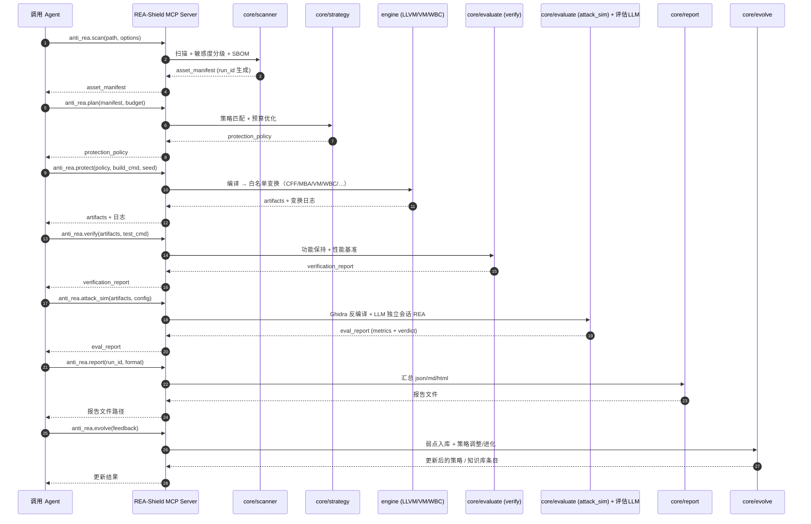

# 端到端场景：AI Agent 经 MCP 调用 REA-Shield

> S2 详细设计**集成主线**。所有模块详细设计（DD-01…DD-08）都必须能支撑本场景跑通；
> 若某处设计与本场景冲突，以「可执行、可验证」为准。

## 文档信息

- **版本**：v1.0
- **日期**：2026-10-15
- **上游**：`HLD.md` v1.1 §2（分层组件图）、`interfaces.md` v1.1 §3（MCP 契约）、`SRS.md` v1.2 §4.2/§4.3、`schemas/*`
- **关联 FR**：FR-D6（MCP Server）、FR-A*…FR-G*（见 §8 映射）

---

## 1. 目的与范围

描述一个 **AI Agent 作为唯一使用方**，经 MCP 工具完成「一次完整反逆向加固运行」的主成功路径、判定门禁与异常/降级路径。范围覆盖 `scan → plan → protect → verify → attack_sim → report → evolve` 的工具编排；不覆盖变换算法内部细节（属各 `dd-*.md`）。

## 2. 角色

| 角色 | 说明 |
| :--- | :--- |
| **调用 Agent** | 上层 AI（如本会话模型），经 MCP JSON-RPC 调用工具、解释结构化结果、决定下一步 |
| **REA-Shield MCP Server** | 对外暴露 7 个工具（`interfaces.md §3`），内部编排 `core/`（Python）与 `engine/`（C++） |
| **评估 LLM** | 运行环境提供的 LLM（**不绑定供应商**，ADR-004），在攻击模拟中扮演 REA 对手 |
| **人工技术负责人** | 处理需要审批/授权的拒绝执行与超预算降级 |

## 3. 前置条件与假设

- **A1**：Agent 对目标工程拥有合法所有权（否则触发 FR-A6 / CQ-03 拒绝执行）。
- **A6**：MCP Server 以 stdio JSON-RPC 运行；每个工具均有 JSON Schema 供 Agent 发现（`interfaces.md §3`）。
- **A2**：攻击模拟所需 LLM 可用且有预算；否则可退化为 `static_only` 模式（见 §9）。
- 目标平台在支持范围（Linux x86_64/arm64、Windows x64；NFR-05）。

## 4. 端到端时序（主成功路径）



### 步骤表

| # | 工具 | 输入 | 输出（数据契约） | 幂等 | 失败处置 |
| :--- | :--- | :--- | :--- | :--- | :--- |
| 1 | `anti_rea.scan` | `path`、`options?` | `asset_manifest`（含 `run_id`） | 只读幂等 | `E_INVALID_INPUT` / `E_REFUSED` / `E_UNSUPPORTED_PLATFORM` |
| 2 | `anti_rea.plan` | `manifest`、`budget` | `protection_policy` | 确定性 | `E_SCHEMA_VIOLATION` / `E_BUDGET_EXCEEDED` |
| 3 | `anti_rea.protect` | `policy`、`build_cmd?`、`seed?` | `artifacts` + 变换日志 | 同 seed 确定性 | `E_BUILD_FAILED` / `E_TRANSFORM_FAILED` / `E_SCHEMA_VIOLATION` |
| 4 | `anti_rea.verify` | `artifacts`、`test_cmd?` | `verification_report` | 只读幂等 | `E_VERIFY_FAILED`（退出码 2） |
| 5 | `anti_rea.attack_sim` | `artifacts`、`config?` | `eval_report` | 只读幂等 | `E_LLM_UNAVAILABLE`（可降级，见 §9） |
| 6 | `anti_rea.report` | `run_id`、`format` | 报告文件 | 确定性 | `E_INVALID_INPUT` |
| 7 | `anti_rea.evolve` | `feedback` | 更新后的策略 / 知识库条目 | 非幂等（有状态） | `E_SCHEMA_VIOLATION` |

## 5. 关键设计约定

### 5.1 `run_id` 生命周期

- `run_id` 在**步骤 1（scan）创建**并写入 `asset_manifest.run_id`；
- 之后的每个产物（policy 的 `seed`、verify/attack_sim 报告、变换日志）**携带同一 `run_id`**；
- `report(run_id)` 以该 id 汇总一次运行的全部产物（FR-G1/G2）；
- Agent 可在任意后续步骤用 `run_id` 关联同一运行。

### 5.2 `seed` 与可复现（NFR-04/NFR-08）

- `plan` 可携带 `seed`；`protect` 使用 `policy.seed`（缺省则由宿主生成并写入产物元数据）；
- 相同 `输入指纹 + seed + 引擎版本` ⇒ 逐位一致产物（`interfaces.md §1.3`）。

### 5.3 数据契约边界（fail-fast）

- 每次工具跨界传递的 `manifest/policy/verification_report/eval_report` 必须在边界处经 `schemas/*.schema.json`（Draft 2020-12）校验；
- 校验失败立即中止并返回 `E_SCHEMA_VIOLATION`（含字段定位）。

### 5.4 选择性变换与合规（FR-C6 / CQ-01…03）

- `protect` **只**对 `policy.assets[].strategies` 非空且 `asset_manifest.skip_transform=false` 的资产施加变换；
- 开源/`skip_transform=true` 资产**零改动**（字节级比对为验收证据）；
- 拒绝执行（所有权不明/疑似恶意）在 `scan` 阶段即中止，**不产出任何变换产物**。

## 6. 判定与门禁

| 门禁 | 触发点 | 规则 | 结果 |
| :--- | :--- | :--- | :--- |
| **G1 合规门** | scan | 所有权不明 / 疑似恶意 / 开源组件识别 | 拒绝执行 → `E_REFUSED`（FR-A6/CQ-03） |
| **G2 预算门** | plan | 预测开销超 `performance_budget` | 自动降级 + 告警（`E_BUDGET_EXCEEDED`，FR-B3） |
| **G3 功能保持门** | protect / verify | 目标工程测试套件 + 差分 fuzz | 未过 → `E_VERIFY_FAILED`；`policy.verification.abort_on_failure` 决定是否中止（FR-D7） |
| **G4 防护效果门** | attack_sim | 六项指标 + 会话上下文消耗判定 | `eval_report.verdict.pass`（判定口径见 `decisions/OI-07-*.md`） |

> `protect` 内部的验证由 `policy.verification.run_tests` 驱动；`anti_rea.verify` 产出**持久化**的 `verification_report`（FR-E1/E2）。二者共用同一功能保持判定，但产物落点不同。

## 7. 成功判据

一次端到端运行「成功」= 同时满足：

1. **产物齐备**（FR-G1）：`asset_manifest` + `protection_policy` + `artifacts` + 变换日志 + `verification_report` + `eval_report` + 报告，均落统一目录并带 `run_id`；
2. **功能保持**（FR-E1）：`verification_report.functional_pass = true`；
3. **性能达标**（FR-E2）：`verification_report.performance_pass = true`（逐资产开销在预算内）；
4. **合规**（CQ）：开源零改动、无拒绝执行漏判；
5. **防护有效**（FR-E3，NFR-02）：`eval_report.verdict.pass = true`，即「独立会话上下文消耗 ≥ 90% 仍未成功 REA」（**判定口径见 `decisions/OI-07-rea-success-criteria.md`**）。

## 8. FR ↔ 场景步骤映射（RTM 输入）

| FR | 覆盖步骤 | FR | 覆盖步骤 |
| :--- | :--- | :--- | :--- |
| FR-A1…A7 | 1 scan | FR-E1/E2 | 3/4 protect+verify |
| FR-B1…B6 | 2 plan | FR-E3…E6 | 5 attack_sim |
| FR-C1…C12 | 3 protect | FR-E7/E8 | 6 report / 5 回归 |
| FR-D1/D6/D7 | 全程（CLI/MCP/门禁） | FR-F1…F4 | 7 evolve |
| FR-G1…G3 | 全程产物 / 6 report | CQ-01…05 | G1 门禁 / 5 LLM 出站 |

> 完整逐条映射在 `dd-09-test-plan.md` 收口，并回填 `docs/requirements/rtm.md` 的「设计归属 / 测试」列。

## 9. 异常与降级路径

| 场景 | 处理 |
| :--- | :--- |
| **LLM 不可用**（`E_LLM_UNAVAILABLE`） | `attack_sim` 支持 `config.mode`：`full`（默认，需 LLM）与 `static_only`（仅 Ghidra 静态指标，`token_ratio`/会话判定缺失并在 `verdict.reasons` 标注「未做 LLM 判定」）；超时/限额同样降级 |
| **超预算**（`E_BUDGET_EXCEEDED`） | `plan` 自动降级策略（降低 coverage / 阶数 / 关闭 VM），给出降级前后对照（FR-B3） |
| **变换破坏语义**（`E_TRANSFORM_FAILED`） | 按 `FR-C12` 回滚该资产变换或中止；记录到变换日志 |
| **验证失败**（`E_VERIFY_FAILED`） | `abort_on_failure=true` 中止构建（退出码 2）；否则打标继续并告警 |
| **拒绝执行**（`E_REFUSED`） | 立即中止，生成拒绝报告，无任何变换产物（FR-A6） |
| **LLM 出站未授权**（CQ-05） | `attack_sim` 需显式开启外部 LLM 出站；未开启则强制 `static_only`，不得静默出站 |

## 10. Agent 调用示例（JSON-RPC 片段）

```jsonc
// → anti_rea.scan
{ "jsonrpc": "2.0", "id": 1, "method": "anti_rea.scan",
  "params": { "path": "/work/app", "options": { "assets_yaml": "/work/assets.yaml" } } }

// ← 成功
{ "jsonrpc": "2.0", "id": 1, "result": {
    "schema_version": "1.0", "run_id": "run-20261015-0001",
    "assets": [ { "id": "a1", "path": "src/crypto/keymgr.c", "type": "crypto",
                  "sensitivity": "P0", "skip_transform": false, "source": "auto" } ],
    "summary": { "total": 1, "by_sensitivity": { "P0": 1, "P1": 0, "P2": 0, "P3": 0 } } } }

// ← 失败（统一错误对象，interfaces.md §1.2）
{ "jsonrpc": "2.0", "id": 1, "error": {
    "code": "E_REFUSED", "message": "所有权不明，拒绝执行", "stage": "scan" } }
```

## 11. 验收场景清单（供 `dd-09-test-plan.md` 展开）

| 编号 | 类型 | 场景 | 期望 |
| :--- | :--- | :--- | :--- |
| E2E-01 | IT | 主成功路径（自有工程 + LLM 可用） | 7 步全通，§7 五条成功判据全满足 |
| E2E-02 | IT | 开源组件混入 | 开源文件字节级零改动（G1/CQ-01） |
| E2E-03 | IT | 所有权不明 | `scan` 返回 `E_REFUSED`，无变换产物 |
| E2E-04 | IT | 预算不足 | `plan` 自动降级并告警（G2） |
| E2E-05 | IT | 变换破坏语义（人为） | `E_TRANSFORM_FAILED` 回滚/中止（FR-C12） |
| E2E-06 | IT | LLM 不可用 | 降级 `static_only`，`verdict.reasons` 标注 |
| E2E-07 | IT | 相同输入+seed 复现 | 产物逐位一致（NFR-04） |
| E2E-08 | AT | 防护效果 | `verdict.pass=true`（≥90% 上下文未成功 REA） |
| E2E-09 | IT | `run_id` 贯穿 | 全部产物同一 `run_id`，`report` 可汇总 |
| E2E-10 | IT | 契约校验 | 任一越界数据违规即 `E_SCHEMA_VIOLATION` |

## 12. 待细化（移交各 dd-*.md）

- 各工具**入参/出参的完整 JSON Schema**（当前为摘要，`interfaces.md §3`）→ 在对应 `dd-*.md` 给出字段级定义；
- `plan` 的**开销预测模型**与降级策略选择算法 → `dd-02-strategy.md`；
- `attack_sim` 的**会话编排与上下文计量口径** → `dd-07-evaluation.md` + `decisions/OI-07-*.md`；
- `evolve` 的**反馈 schema 与知识库结构** → `dd-08-adaptive.md`。
